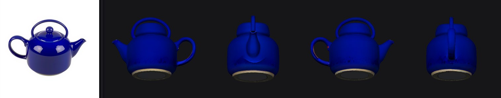
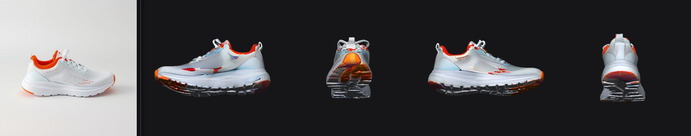
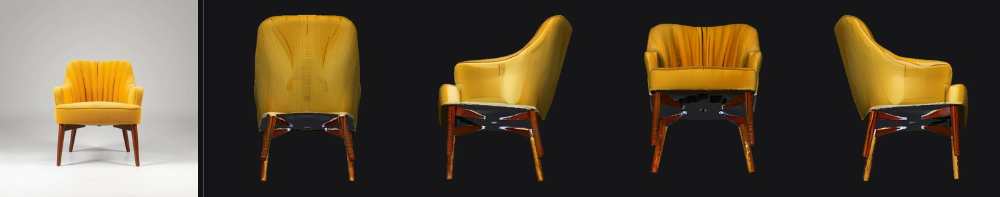

# Experimental Intel XPU fork

**Interactive model gallery:** [Intel 3D Studio](https://3d.fireorbooty.com/) — rotate, zoom, inspect materials and download the generated assets. [Viewer deployment documentation](viewer/README.md).

Intel development is on `dev`. Start with [Intel port status and diagnostics](docs/intel/README.md). A complete shape → PBR texture → GLB test passed on Arc Pro B70 at the safe preset. [Results and previews](docs/intel/e2e-2026-10-15/README.md). Visual quality and higher presets remain unqualified. The original documentation below describes the upstream AMD/Apple port, not a working Intel installer.

---

# Hunyuan3D 2.1 without CUDA — Apple Silicon (MPS) and AMD (ROCm)

**Run Tencent's Hunyuan3D 2.1 image-to-3D model on hardware it was never shipped for:** Apple Silicon Macs via Metal Performance Shaders, and AMD GPUs via ROCm on Linux or Windows. No NVIDIA GPU, no Linux VM, no cloud.

This repository provides turnkey installers, a runtime compatibility layer, and a localized Gradio web UI (English / 中文 / Русский) around the upstream [Tencent Hunyuan 3D 2.1](https://github.com/Tencent-Hunyuan/Hunyuan3D-2.1) project. Feed it one PNG/JPG, get a `.obj` / `.glb` / `.ply` / `.stl` / `.fbx` / `.dae` / `.3mf` mesh — and, now, **PBR textures**.

**Keywords:** Hunyuan3D, Hunyuan 3D 2.1, image to 3D, AMD, ROCm, HIP, Radeon, Strix Halo, gfx1151, Ryzen AI Max, Mac, macOS, Apple Silicon, M1, M2, M3, M4, Metal Performance Shaders, MPS, PyTorch, 3D generation, PBR texturing, mesh generation, DiT, Tencent.

---

## What works where

| | Shape (DiT + VAE) | Texturing (PBR) | Rasterizer |
|---|---|---|---|
| **NVIDIA / CUDA** | ✅ GPU | ✅ GPU | native CUDA kernel |
| **AMD / ROCm, Linux** | ✅ GPU | ✅ GPU (flash attention) | native HIP kernel, or pure-PyTorch |
| **AMD / ROCm, Windows** | ✅ **verified** | ✅ **verified at 256 px** | pure-PyTorch |
| **Apple Silicon / MPS** | ✅ **verified** | ✅ **verified at 256 px** | pure-PyTorch on MPS, or native C++ |
| **CPU only** | ✅ (very slow) | ⚠️ (very slow) | pure-PyTorch |

Both pipelines are verified end to end on two machines, neither of which has working flash attention — about as unfavourable as this model gets:

- **Radeon 8060S** (gfx1151, Windows, ROCm 7.2) — an iGPU.
- **Apple M4 Pro** (24 GB, macOS 26, torch 2.13) — `assets/demo.png` → mesh in 344 s (30 steps, octree 192) → PBR texture in 512 s at the «Safe» preset.

What MPS specifically needed, and what turned out not to be a problem, is written up in [`docs/ROCM_TEXTURING_PLAN.md` §10](docs/ROCM_TEXTURING_PLAN.md).

### Texturing has a resolution ceiling without flash attention

Not a memory-size problem. The paint UNet's multiview attention concatenates every view into one sequence, so the score matrix grows with the **square** of views × tokens. Without an efficient SDPA backend PyTorch materialises it in full, and these were measured, not estimated:

| Views | Multiview res | Attention matrix | Result on the 8060S |
|---|---|---|---|
| 4 | 256 px | 1.9 GiB | ✅ works — 517 s (cold kernel cache) |
| 6 | **256 px** | **4.2 GiB** | ✅ **works — 136 s, correct PBR output** |
| 6 | 320 px | 10.3 GiB | ❌ machine hang |
| 6 | 512 px | 67.5 GiB | ❌ no allocator serves it; machine hang |
| 8 | 768 px | 607.5 GiB | ❌ hopeless |

So on hardware without flash attention, **use the «Safe» preset (6 views at 256 px)**. It is the default suggestion there, and `paint.attention_preflight()` refuses anything over the limit before doing any work — 5 GiB on ROCm, because above the ceiling the failure mode is a GPU driver reset that takes the machine down rather than an exception you can catch.

Apple Silicon is in the same position — PyTorch's MPS SDPA is an MPSGraph matmul plus softmax, not a flash kernel — but the consequence of overshooting is milder: Metal refuses an over-large buffer with `RuntimeError: Invalid buffer size` instead of resetting the display driver. Measured on an M4 Pro (24 GB): a single 12 GiB allocation succeeds, 24 GiB does not. So the limit there is derived from the pool (40 % of `torch.mps.recommended_max_memory()`, floored at the 5 GiB ROCm figure) rather than fixed, and the refusal message says what it will actually cost you — a much longer run, not a reboot.

Tuning, if you want to explore: `HY3D_ATTN_LIMIT_GIB` raises the refusal threshold, `HY3D_ALLOW_RISKY_TEXTURING=1` disables the check entirely. `python scripts/doctor.py` reports the verdict for your hardware.

### Windows: raise the TDR timeout before running this

On Windows the display driver has a watchdog — Timeout Detection and Recovery. If a single GPU operation does not return within **2 seconds** (the default), Windows resets the GPU. You see the screen flash black and AMD offers to send a bug report.

That matters here because the reset does not stop your Python process. It keeps running on a GPU that now returns **wrong numbers**: after a reset on this machine a 1024×1024 matmul of ones gave 947.3 instead of 1024.0, while reductions stayed exact. Meshes and textures silently come out corrupt, and it looks like a bug in the pipeline. This is the single most confusing failure mode on this platform.

Diffusion and baking kernels routinely exceed 2 s, so raise the limit. In an **administrator** PowerShell:

```powershell
New-ItemProperty -Path 'HKLM:\SYSTEM\CurrentControlSet\Control\GraphicsDrivers' -Name TdrDelay -PropertyType DWord -Value 60 -Force
```

Then reboot. The trade-off is honest: a genuinely hung kernel now freezes the desktop for 60 s instead of 2 before recovering. That is the right trade for compute work, and it is why `scripts/doctor.py` checks GPU arithmetic — so a reset that slips through is caught before you trust the output.

Two dead ends worth knowing about, so you do not repeat them:

- `TORCH_ROCM_AOTRITON_ENABLE_EXPERIMENTAL=1` does enable flash attention — and **segfaults** on gfx1151.
- **Never set `MIOPEN_FIND_MODE=FAST`.** It looks like a free win (it skips convolution autotuning) but it routes MIOpen through a fallback that hands solvers a null workspace and then dereferences it. It killed the convolution-heavy paint pipeline in under two minutes, and was the real cause of crashes originally mistaken for memory pressure.

One more rough edge, patched here rather than worked around: upstream's scheduler looks up the current step with exact float equality (`(schedule_timesteps == timestep).nonzero()`), and when nothing matches it raises `IndexError` and throws away a generation that is already minutes in. `compat_patches.patch_scheduler_timestep_lookup()` falls back to the nearest timestep, which is what current diffusers does.

Earlier versions of this README claimed texturing was impossible without CUDA. That was wrong, and it is worth being specific about why, because the reasoning is the whole design:

- **`custom_rasterizer` already ships a complete CPU implementation.** `rasterize_image` dispatches on the input tensor's device; only `rasterizer_gpu.cu` is CUDA. The CUDA kernel is not load-bearing.
- **`mesh_inpaint_processor` never touches CUDA or torch** — it is plain pybind11 + STL and compiles on every platform.
- **`xformers`, `flash-attn`, `bitsandbytes` and `cupy` are not imported anywhere** in the inference path, despite appearing in upstream's `requirements.txt`.
- Everything else was hardcoded `"cuda"` strings, which this port redirects at runtime.

## The rasterizer, and why there are three of them

Texturing needs to rasterize triangles. There are three ways to get that here, chosen automatically:

| mode | what it is | when it is used |
|---|---|---|
| `gpu` | upstream's CUDA kernel, hipified for ROCm | Linux/ROCm and CUDA, when the build succeeds |
| `cpu` | upstream's built-in CPU path | when a native build works but device code does not; on macOS, built but not default |
| `torch` | [`torch_rasterizer.py`](torch_rasterizer.py) — a PyTorch reimplementation | everywhere else, and always available |

The pure-PyTorch rasterizer is not a consolation prize. It needs no compiler, it runs on whatever device the tensors are already on, and at 80k triangles / 2048×2048 it costs **~80 ms per call on a Radeon 8060S** — against minutes for the multiview diffusion that dominates texturing. It is checked against a line-by-line transcription of upstream's C++ loops in [`tests/test_torch_rasterizer.py`](tests/test_torch_rasterizer.py): identical face indices, barycentric coordinates matching to ~4e-6.

It exists because on **Windows + ROCm neither native mode is buildable**, for two independent reasons:

1. The `rocm-sdk` wheels ship the HIP runtime but no HIP headers and no offline compiler — `include/`, `lib/` and `cmake/` under `_rocm_sdk_devel` are empty.
2. More fundamentally, the Windows ROCm torch wheel cannot link *any* C++ extension: `c10.lib` does not export `c10::ValueError(SourceLocation, std::string)`, so even an empty `PYBIND11_MODULE` over `<torch/extension.h>` fails with `LNK2001`.

It is also the clean-room comparison for [ROCm/ROCm#5981](https://github.com/ROCm/ROCm/issues/5981) — corrupted texture output on ROCm, root cause unknown. Switching between `--raster gpu` and `--raster torch` isolates whether the HIP kernel is at fault, since the two share no code.

### On a Mac, `torch` is the default — and that is a measurement

The native `cpu` build does work on macOS, but it is a *CPU* path: using it on an MPS device means copying vertex positions down and the index map back on every view. At 79k triangles the round trip costs more than it saves:

| | native C++ (CPU) | torch on CPU | torch on MPS |
|---|---|---|---|
| 1024² | 51.8 ms | 63.5 ms | 47.6 ms |
| 2048² | 165.1 ms | 237.5 ms | **151.6 ms** |

The native path and `torch_rasterizer` agree exactly on face indices and to 1.6e-5 on barycentrics — which is what makes `HY3D_RASTER=cpu` worth having on a Mac even though it is not the default: an independent implementation to compare against if a bake ever looks wrong.

Making the native build work on macOS took two fixes, both applied by `build_extensions.py` to a staged copy under `.build/`, never to your clone:

1. `float vt[2] = {px + 0.5, py + 0.5};` — `int + 0.5` is a `double`, and narrowing it inside a braced initialiser has been ill-formed since C++11. MSVC and GCC let it through with a warning; clang rejects it outright.
2. The built `.so` referenced `@rpath/libc10.dylib` with no rpath recorded, so it compiled, installed, and then failed at import with `Library not loaded`. The generated `setup.py` now bakes torch's lib directory in.

---

## Install

### AMD on Windows

Requires Python 3.10–3.12, git, and a working ROCm PyTorch. The script will **not** install torch over a working one, because the correct wheel is architecture-specific.

```bash
powershell -ExecutionPolicy Bypass -File scripts\install_rocm_windows.ps1
```

If you have no ROCm torch yet, the script prints the right command for your GPU and exits. For gfx1151 (Radeon 8060S / Ryzen AI Max+ 395), gfx1200 and gfx1201:

```bash
python -m pip install --index-url https://rocm.nightlies.amd.com/v2/gfx1151/ torch torchvision torchaudio
```

Do **not** use the pytorch.org ROCm wheels on a ROCm 7.x runtime — they are built against ROCm 6.x and segfault on GPU memory access.

### AMD on Linux

```bash
chmod +x scripts/install_rocm.sh
./scripts/install_rocm.sh
```

Detects your `gfx` architecture with `rocminfo`, picks the matching wheel index, then builds the native rasterizer (hipify reports zero unsupported CUDA calls on these sources). Options: `--shape-only`, `--skip-weights`, `--raster {auto,gpu,cpu,torch}`, `--install-torch`.

### Apple Silicon

```bash
chmod +x install.sh
./install.sh
```

Installs **both** pipelines. In order: torch from PyPI (the MPS build is the ordinary wheel), `requirements_mac.txt`, the native extensions via `scripts/build_extensions.py`, then the shape weights (~15 GB), the paint weights (~6.5 GB), `facebook/dinov2-giant` (~4.5 GB) and the RealESRGAN checkpoint. Budget about 30 GB and a long download.

Options: `--shape-only` skips everything texturing needs, `--skip-weights` downloads nothing. It finishes by running `scripts/doctor.py`, which says whether each pipeline is actually usable rather than whether the files merely exist.

Only one native module is required — `mesh_inpaint_processor`, plain pybind11 with no CUDA in it. The rasterizer needs no compiler at all on a Mac: the default is `torch`, which runs on MPS, so nothing is bounced to the CPU. The native C++ rasterizer is built anyway and is selectable with `HY3D_RASTER=cpu` or `./launch.sh --raster cpu`; see [the rasterizer section](#the-rasterizer-and-why-there-are-three-of-them) for why it is not the default and why it is still worth having.

If you installed before texturing worked here, `./fix.sh` brings an existing install up to date without redoing it from scratch.

---

## Run

```bash
./launch.sh
```

On Windows:

```bash
powershell -ExecutionPolicy Bypass -File launch.ps1
```

Open the URL Gradio prints (usually http://127.0.0.1:7860). Upload an image, **Generate**, wait, preview, optionally post-process, optionally texture, download.

Useful overrides on both launchers: `--raster {gpu,cpu,torch}`, `--backend {rocm,cuda,mps,cpu}`, `--port N`. They map to the `HY3D_RASTER`, `HY3D_BACKEND` and `HY3D_DTYPE` environment variables, which exist so you can bisect backend-specific problems without editing code.

### Attention speed on AMD

On consumer and APU AMD GPUs, PyTorch disables the flash and mem-efficient SDPA backends and says so at runtime:

> Flash Efficient attention on Current AMD GPU is still experimental. Enable it with `TORCH_ROCM_AOTRITON_ENABLE_EXPERIMENTAL=1`

So attention runs on the math backend by default. `--fast-attention` (PowerShell: `-FastAttention`) sets that variable and enables the AOTriton kernels, which can be considerably faster. It is opt-in because it is an experimental path — if you turn it on, check that the output still looks right.

This is also why upstream's `sdp_kernel(enable_math=False)` had to be relaxed: with both other backends disabled, forbidding math left PyTorch with no kernel at all and it raised `RuntimeError: No available kernel`.

### Measured end to end

Same input (`assets/demo.png`), same settings, two machines. Both are worst-case for this model: neither has flash attention, so both ran the «Safe» preset.

| Step | Setting | Radeon 8060S<br>gfx1151, Windows, ROCm 7.2 | Apple M4 Pro<br>24 GB, macOS 26, torch 2.13 |
|---|---|---|---|
| Shape generation | 30 steps, octree 192 | ~6.4 min | 5.7 min (7.6 s/step) |
| PBR texturing | 6 views, 256 px | ~2.5 min | 8.5 min |
| Rasterization (per call) | 80k faces, 2048² | ~80 ms | 152 ms |
| Preview render (4 views) | 448², textured | ~1 s | ~1 s |

Reproduce either with:

```bash
python tests/e2e_visual.py --steps 30 --octree 192 --tex-preset safe --tex-views 6 --tex-resolution 256
```

Attention ran on the math backend for the AMD numbers (no `--fast-attention`); MPS has no faster path to enable. Enabling the op tracker makes generation roughly an order of magnitude slower — it is a diagnostic, not something to leave on.

Texturing is markedly slower on the Mac than on the APU. 24 GB is tight for this stage — the run peaks at roughly 8 GB of swap — so a Mac with more unified memory would likely do better, though that has not been measured here.

## Check the install

```bash
python scripts/doctor.py
```

Reports the detected backend, dtype, rasterizer, extension build state, weights, and imports — then says plainly whether shape generation and texturing are each usable, and what to fix if not. It also checks the two things that are easy to miss because upstream fetches them lazily: the RealESRGAN checkpoint, and whether `facebook/dinov2-giant` is in the Hugging Face cache.

It also **verifies the GPU still does correct arithmetic**, which is not paranoia on this hardware. After a driver reset the AMD GPU kept running and kept returning wrong results: a 1024×1024 matmul of ones gave 947.3 instead of 1024.0, while reductions stayed exact. Nothing raises in that state — meshes and textures just come out corrupt, and it looks like a bug in the pipeline. If you see

```
[FAIL]  gpu arithmetic   WRONG RESULTS: matmul mean 947.3, expected 1024
```

reboot before trusting any output.

## Examples

All of these were produced on the Radeon 8060S described above — input on the left, four turntable views of the textured result on the right. Shape at 30 steps / octree 192, texturing with the «Safe» preset (6 views at 256 px). Roughly 6 minutes for the shape and 2.5 for the texture, each.

**Curved surfaces and a genuine hole in the handle — a topology test.** The hole survives, and the unglazed foot ring is textured separately from the glaze.



**Hard-surface with thin limbs and an antenna.** Panel lines, chest plate and boots all reconstruct; the antenna survives despite being a few pixels wide in the input.


**Mixed materials in one object — the real PBR test.** Sole tread, mesh upper and laces separate cleanly.



**Large soft volumes plus slim legs.** Note the underside of the seat: surfaces no camera saw are the weakest part of any 6-view bake.



### What makes a good input

One object, centred, whole silhouette in frame with margins, plain background, even lighting, no text or watermark. A cropped subject or a busy scene reconstructs badly no matter how good the photo is.

The fifth image in the set, `owl.jpg`, is kept deliberately as a **failure case**: it was lit to cast a soft shadow on a visible floor, background removal kept the floor, and the model reconstructed a large flat disc with a small owl sitting on it. If your result comes out sitting on a plate, this is why — remove the ground plane from the input, or shoot against a seamless backdrop with no visible horizon.

---

## Features in the UI

- **Language switcher** — English / 中文 / Русский. Console logs stay in English.
- **Background removal** — optional, via rembg.
- **Inference parameters** — steps, guidance scale, octree resolution, seed.
- **GPU vs CPU op tracker** — intercepts every tensor op via `torch.overrides.TorchFunctionMode` and reports what fraction actually ran on the GPU, plus the top ops that leaked to CPU.
- **Mesh post-processing** — four decimation algorithms (quadric / iso / planar / hybrid / auto) at four strengths, always re-applied to the original mesh so switching presets does not compound error.
- **PBR texturing** — albedo + metallic-roughness generation and UV baking, with a memory preset, view count, multiview resolution and rasterizer selector. Outputs a textured GLB with a real PBR material, or a zip of OBJ + MTL + maps.
- **Seven export formats** for untextured geometry, chosen at download time.

## What's new in this port

Beyond running on non-CUDA hardware at all:

- **PBR texturing without CUDA.** Albedo and metallic-roughness generation plus UV baking, verified end to end on both ROCm and Apple MPS. Outputs a GLB with a real PBR material or a zip of OBJ + MTL + maps.
- **A rasterizer that needs no compiler** — [`torch_rasterizer.py`](torch_rasterizer.py), pure PyTorch, checked against a line-by-line transcription of upstream's C++ in [`tests/test_torch_rasterizer.py`](tests/test_torch_rasterizer.py). This is what makes texturing possible on Windows, where the ROCm torch wheel cannot link any C++ extension.
- **Attention that fits.** Chunked SDPA bounds the peak allocation on GPUs without flash attention, and is bit-identical to the unchunked result ([`tests/test_sdpa_chunking.py`](tests/test_sdpa_chunking.py)).
- **A preflight that refuses instead of crashing.** Settings above what the GPU can survive are rejected with an explanation and a per-backend limit — on ROCm because the failure mode is a machine reset, on MPS because Metal will not hand out the buffer and the chunked fallback would take hours.
- **Two Metal-specific fixes that are not optional.** Upstream calls `torch.isin` on two large index vectors in `MeshRender.back_project`; on MPS PyTorch picks the broadcast algorithm and asks Metal for their product — a measured **111 GB** in one buffer, which kills the process on a Metal assertion no `try/except` can catch. And `_convert_texture_format` copies a float64 array to the device before narrowing it, which Metal has no type for. Both are replaced at runtime, MPS only. See [`NOTICE`](./NOTICE) for the full list of changes.
- **Blender-free export.** Upstream's mesh I/O and GLB conversion go through `bpy`; [`mesh_io.py`](mesh_io.py) replaces both.
- **Diagnostics** — [`scripts/doctor.py`](scripts/doctor.py) tells you which pipelines actually work here, including whether the GPU is still returning correct results.
- **A visual test suite** — rasterizer conformance rendered as images, turntable previews, and a self-contained HTML report ([`tests/build_report.py`](tests/build_report.py)).
- **A texturing test that needs no weights.** [`tests/test_paint_render.py`](tests/test_paint_render.py) drives the whole non-diffusion half of the paint pipeline — UV unwrap, rasterization, back-projection, cosine-weighted baking, UV inpainting, GLB export — on a real mesh with the production patches installed, then **runs it again on CPU and compares the two textures**. That cross-check is what found both Metal bugs above, and it costs a few seconds instead of a 6.5 GB download.

## Memory

Texturing is far hungrier than shape generation — upstream's defaults (8 views at 768, 2048² renders, 4096² textures) want roughly 21 GB. Three presets are provided:

| preset | views | multiview res | render | texture | attention matrix |
|---|---|---|---|---|---|
| **Safe** | 6 | 256 | 1024 | 2048 | 4.2 GiB |
| Low | 6 | 512 | 1024 | 2048 | 67.5 GiB |
| Normal | 8 | 768 | 2048 | 4096 | 607.5 GiB |

The last column is why «Safe» is the default everywhere except CUDA, and why the jump from it is so steep: the cost is quadratic in views × tokens, not linear in either. **Low and Normal need flash attention** — on ROCm and MPS they are refused by the preflight rather than attempted.

Pool size only selects the preset on **CUDA**, where flash attention makes the attention matrix a non-issue and 24 GB of VRAM is enough for `Normal`. Everywhere else the binding constraint is that matrix rather than the pool, so the suggestion is `Safe` regardless of how much memory the device reports — a machine with 100 GiB of GPU-visible memory still cannot run `Low`. `scripts/doctor.py` prints the pool anyway, because it is what the preflight limit is derived from: on an APU it is the VRAM carve-out rather than total system RAM (a 128 GB Strix Halo can report ~108 GiB), and on a Mac it is `torch.mps.recommended_max_memory()`, about 75 % of unified memory.

The shape and paint pipelines are **never resident at once**: the DiT is unloaded before the paint model loads. Holding both is the usual reason texturing OOMs on machines that could otherwise manage it.

On macOS the port also sets `PYTORCH_MPS_HIGH_WATERMARK_RATIO=0.0`, which lifts PyTorch's soft allocation cap. That is deliberate: with the cap in place, texturing on a 24 GB Mac aborts with an OOM several minutes in; without it, macOS pages and the run finishes. Paging is the better failure mode here, but it does mean the machine will feel slow while a bake is in flight.

---

## Project layout

```
hunyuan3d-2.1-mac-rocm/
├── backend.py             ← device / dtype / rasterizer detection and policy
├── compat_patches.py      ← torch-level patches (MPS/CPU only, no-op on ROCm)
├── paint.py               ← PBR texturing wrapper + paint-pipeline patches
├── mesh_io.py             ← Blender-free OBJ/MTL/GLB export
├── torch_rasterizer.py    ← pure-PyTorch rasterizer (no compiler needed)
├── lowpoly.py             ← decimation algorithms
├── gradio_app.py          ← the trilingual Gradio app
├── launch.sh / launch.ps1 ← backend-aware launchers
├── install.sh, fix.sh     ← macOS installer and repair script
├── requirements_mac.txt
├── requirements_rocm.txt
├── scripts/
│   ├── install_rocm.sh            ← Linux/ROCm installer
│   ├── install_rocm_windows.ps1   ← Windows/ROCm installer
│   ├── build_extensions.py        ← native extension builds, with fallbacks
│   └── doctor.py                  ← installation diagnostics
├── tests/
│   ├── test_torch_rasterizer.py   ← rasterizer conformance vs upstream's C++
│   ├── test_sdpa_chunking.py      ← chunked attention equivalence
│   ├── test_paint_render.py       ← render/bake/export, and device vs CPU (no weights)
│   ├── visual_rasterizer.py       ← conformance rendered as images
│   ├── render_preview.py          ← turntable previews (no OpenGL needed)
│   ├── e2e_visual.py              ← image → mesh → texture → report
│   └── build_report.py            ← assemble a report from existing artifacts
├── assets/examples/       ← test images for image-to-3D
├── docs/ROCM_TEXTURING_PLAN.md    ← design notes and findings
├── LICENSE                ← Tencent Hunyuan 3D 2.1 Community License (model)
├── LICENSE-WRAPPERS       ← MIT (the wrapper code above)
└── NOTICE                 ← Tencent Notice + this port's statement of changes
(after install, none of it tracked)
├── Hunyuan3D-2.1/         ← upstream clone
├── weights/               ← Hugging Face weights
├── .build/                ← extension build records and staged sources
├── .cache/                ← MIOpen kernel cache
└── outputs/               ← your generated meshes
```

---

## Known limitations

- **Windows/ROCm has no native rasterizer.** By design — see above. The pure-PyTorch one is used and is fast enough.
- **gfx1151 is not in AMD's official ROCm support matrix.** It works with the TheRock nightly wheels, which ship native gfx1151 kernels (no `HSA_OVERRIDE_GFX_VERSION` needed), but you are on nightlies.
- **Corrupted textures on ROCm are a known open issue** ([ROCm/ROCm#5981](https://github.com/ROCm/ROCm/issues/5981)). If you hit it, compare `--raster gpu` against `--raster torch`, and try `HY3D_DTYPE=float32`.
- **First run is slow on ROCm** while MIOpen autotunes convolutions. The cache is kept in `.cache/miopen`, so this is paid once.
- **Texturing on MPS is slow, and on a 24 GB Mac it swaps.** 512 s for the «Safe» preset on an M4 Pro, with roughly 8 GB of swap at the peak. `PYTORCH_MPS_HIGH_WATERMARK_RATIO=0.0` is set deliberately: with PyTorch's soft cap in place the stage would abort with an OOM several minutes in instead of paging.
- **`facebook/dinov2-giant` is a separate ~4.5 GB download.** The paintpbr checkpoint conditions on DINO features, so this is not hypothetical — upstream fetches it lazily while the paint model loads, silently, after the shape stage has already been paid for. `install.sh` now downloads it up front and `scripts/doctor.py` warns when it is not cached.

## Troubleshooting

- **"No module named hy3dshape"** — the upstream repo was not cloned. Re-run your platform's installer, or `./fix.sh` on macOS.
- **"mesh_inpaint_processor is not built"** — run `python scripts/build_extensions.py`. It is a plain pybind11 module and builds everywhere; if it fails you are missing a C++ toolchain (MSVC Build Tools on Windows, Xcode CLT on macOS).
- **`LNK2001 ... c10::ValueError`** on Windows — the torch wheel cannot link extensions. Nothing to fix in this repo; the pure-PyTorch rasterizer covers it, and `build_extensions.py` says so explicitly.
- **Segfault on any GPU memory access (ROCm)** — you are on pytorch.org ROCm 6.x wheels with a ROCm 7.x runtime. Reinstall from the nightly index.
- **Out of memory during texturing** — switch to the `Safe` preset, drop the view count or the multiview resolution, and on AMD raise your GPU's VRAM carve-out.
- **Out of memory during shape sampling** — lower `octree_resolution` to 192 or 128, or reduce `num_steps`.
- **`No module named 'timm'` on macOS** — an install from before this was in `requirements_mac.txt`. Run `./fix.sh`, which now installs the whole file rather than a hand-maintained subset.
- **`failed assertion 'Failed to allocate private MTLBuffer'` on macOS** — the process dies without a Python traceback. This is Metal refusing an allocation, and it is what the `torch.isin` patch exists to prevent; if you see it, `compat_patches.apply()` did not run before the paint pipeline. Every supported entry point applies it, so reach for this only if you are driving `MeshRender` yourself.
- **`Cannot convert a MPS Tensor to float64 dtype`** — same shape of problem: Metal has no float64, and the patched `_convert_texture_format` is what avoids it.
- **Texturing stalls while the paint model loads, with no output at all** — it is almost certainly downloading `facebook/dinov2-giant` (~4.5 GB), which prints nothing while it runs. `python scripts/doctor.py` tells you whether it is already cached.

---

## Credits and upstream

Model and original research are by **Tencent Hunyuan**. This port adds no model capability; it exists to make Hunyuan 3D 2.1 run without CUDA.

- Upstream repo: https://github.com/Tencent-Hunyuan/Hunyuan3D-2.1
- Weights: https://huggingface.co/tencent/Hunyuan3D-2.1

If you use this project in research or production, cite the Tencent Hunyuan 3D 2.1 paper and acknowledge upstream Tencent.

---

## License — please read before using

This repository contains **two separately-licensed layers**:

1. The Tencent Hunyuan 3D 2.1 model, weights and any mesh you generate with them are governed by the **TENCENT HUNYUAN 3D 2.1 COMMUNITY LICENSE AGREEMENT** — see [`LICENSE`](./LICENSE).

   Important points:

   - **Territory:** the license does **not** apply in the **European Union, the United Kingdom, or South Korea.** If you are in one of those jurisdictions you may not use the model under this license.
   - **Commercial threshold:** above **100 million monthly active users** you need a separate commercial license from Tencent.
   - **Attribution:** downstream distributions must preserve Tencent's copyright and license text.
   - **State your changes:** every modification this port makes is enumerated in [`NOTICE`](./NOTICE). None of it is redistributed — patches are applied at runtime or to a local copy on your machine.

2. The wrapper code (see the file list in [`NOTICE`](./NOTICE)) is **MIT-licensed** — see [`LICENSE-WRAPPERS`](./LICENSE-WRAPPERS).

This project is **not** affiliated with, endorsed by, or sponsored by Tencent. "Hunyuan" is a trademark of Tencent.

---

## Contributing

Issues and PRs welcome — especially for:

- Native rasterizer builds on Windows/ROCm, if a torch wheel appears that can link extensions.
- Root-causing the ROCm texture corruption issue.
- Further MPS and ROCm speed-ups.
- Additional UI translations.

Please keep PRs scoped to the wrapper files. Upstream Tencent code should be fixed upstream, not vendored here.
