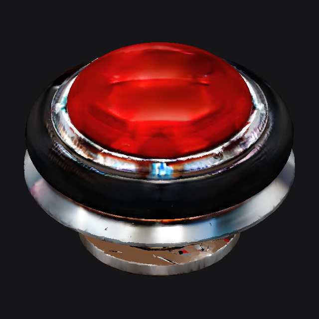

# First pinball bumper generation

Generated 2026-10-15 on one Intel Arc Pro B70 using this port.

- Reference: built-in image generation, classic red-cap round bumper with silver
  trim, black rubber impact ring and short metal pedestal, isolated product view.
- Shape: seed 42, 30 steps, octree 256; 61.1 seconds including model loading.
- Paint: safe preset, six views at 256 px; 43.6 seconds including model loading.
- Export: 40,000 triangles, embedded base-color and metallic/roughness textures.
- `validation.json`: structural checks passed; this does not certify visual quality.
- Qwen was temporarily unloaded with authorization, then restored and health checked.

## Actual model preview

[Download GLB](bumper.glb)

The red cap and rubber ring are recognizable, but the metal and underside have
visible texture artifacts. This is the initial AI-generated asset, not a finished
production/game component. Preview uses albedo plus diffuse shading, not full PBR
reflections. Collision geometry, dimensions, animation and gameplay integration
are not included. The original `reference.png` is the image-generation input,
not a render of the resulting mesh.
