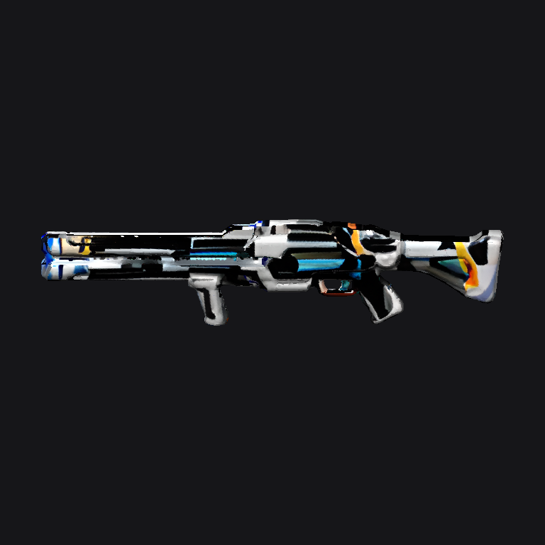

# Instagib railgun — first generation

Generated 2026-10-15 on one Intel Arc Pro B70 using this port.

- Original image-generation reference: graphite sci-fi railgun with cyan energy channel, silver panels and orange accents.
- Shape: seed 42, 30 steps, octree 256; 59.7 seconds including loading.
- PBR texturing: safe preset, six views at 256 px; 45.9 seconds including loading.
- Export: 40,000 triangles; embedded 1024 px base-color and metallic/roughness textures.
- Structural validation passed. Peak XPU allocated memory: about 8.2 GiB.
- Qwen temporarily unloaded with authorization, then restored and health checked.

[Download GLB](railgun.glb)

This is a first-pass AI-generated mesh, not a finished game weapon. The long barrel and grips are recognizable, but surface textures have visible artifacts and some details are softened. Preview uses albedo plus diffuse shading, not full PBR reflections. Cyan color is not an emissive shader. No animation, collision, calibrated dimensions, muzzle attachment or gameplay integration is included. reference.png is the generation input, not a render of the output mesh.

## UV export repair — 2026-10-16

Corrected the double vertical UV conversion in the downloadable GLB. Geometry and embedded texture images are unchanged. The old Python preview compensated for the error on import, hiding the discrepancy with Three.js. Browser material placement is now consistent with the repaired preview renderer. Remaining generated texture defects are still present.
