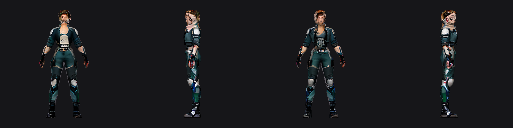

# Woman character generation experiment

Generated 2026-10-16 UTC (October 15 Central) using Hunyuan3D 2.1 Intel port on B70.

Input: built-in imagegen original adult woman, short brown hair, graphite/teal sci-fi clothing, neutral A pose on white background. reference.png is the input image, not the output mesh.

Settings: seed 42, shape 30 steps, octree 256, safe texture preset (six views at 256 px). Shape 60.2 s; texturing 40.2 s including loading. Export: 40,000 triangles, 1024 px embedded base-color and metallic/roughness maps. Structural checks passed; artistic quality failed review.

[Experimental GLB](woman.glb)

Severe texture distortion affects face, head and clothing; face-like detail appears on the back of the head. Limbs are separated but hands and facial detail need reconstruction. Not suitable as a finished game character. No skeleton, skinning, animations, collision or game integration. Preview is albedo plus diffuse shading, not full PBR rendering. Qwen was temporarily unloaded and restored; health endpoint confirmed OK.
