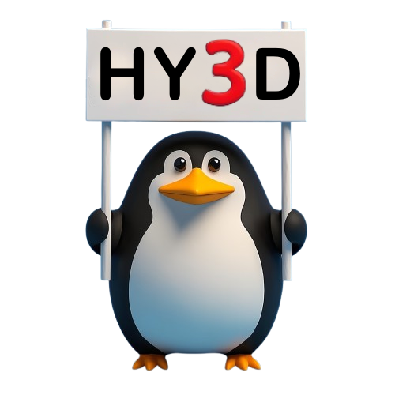
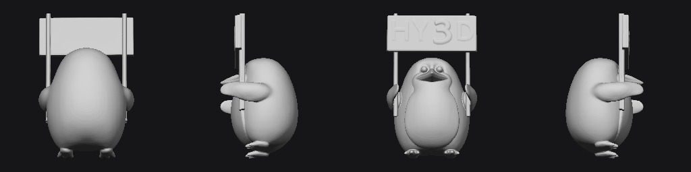
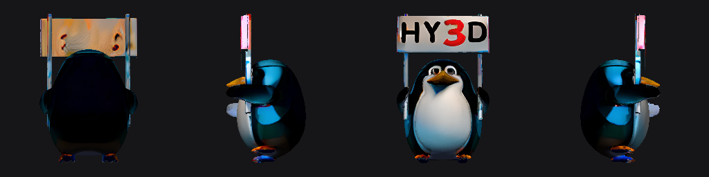

# First complete Intel generation test — 2026-10-15

**Result: shape generation, PBR texturing, GLB export and preview rendering passed
on one Arc Pro B70. Visual quality is not yet qualified for game use.**

| Check | Observed result |
|---|---|
| Input | Public upstream `assets/demo.png`, penguin with HY3D sign |
| Device | XPU:0, Intel Arc Pro B70 32 GB; second B70 unused by generation |
| Shape | FP16, seed 42, 30 steps, guidance 5, octree 192 |
| Shape duration | 91.71 s including first model load and background removal |
| Raw geometry | 89,672 vertices, 179,344 triangles |
| Paint | Safe preset: 6 views at 256 px, render 1024, bake target 2048 |
| Paint duration | 100.58 s including cold loading and auxiliary model download |
| Export | GLB, 22,768 vertices, 40,000 triangles |
| Embedded maps | 1024×1024 base color and packed metallic/roughness |
| Peak torch allocation during paint process | 8,806,630,400 bytes (8.20 GiB) |
| Structural validation | Finite geometry and UVs, valid indices, nonempty embedded PBR maps |

The exporter deliberately halves baked texture dimensions, matching upstream.
PyTorch peak allocation excludes some driver/runtime memory. These first-run
wall times are **not warmed throughput benchmarks**. The two generation stages
ran in separate fresh processes, with the generated mesh passed to paint.

## Visual inspection

The front preserves the character and sign. The sides/back show visible color
and texture artifacts, including invented details on the back of the sign. It is
not yet known how much comes from model limitations, the conservative preset,
or backend/port behavior: no matched CUDA reference comparison was run.
Watertightness is false on the exported, UV-seamed mesh; this is not a physics
collision mesh validation. No claim of production quality or cross-backend parity.

Input (from Tencent's upstream demo):

Generated geometry, four views:

Textured export, four views (preview samples albedo; not a full PBR lighting test):

## Environment and source

- Wrapper branch: `dev`; initial Intel foundation commit `543b1e6` plus this test harness update.
- Tencent code: `82920d643c0dc2f7bfd7255f45f62d386edfe60c`.
- Tencent model revision: `0b94677654c57bb9a6b6845cd7b704ccf551d327`.
- Python 3.12.14, torch 2.13.0+xpu, torchvision 0.28.0+xpu.
- Ubuntu 26.04 Docker image; host Intel runtime 26.22.38646.7.
- Full Python package snapshot: [requirements-tested.txt](../requirements-tested.txt).
- The existing dual-GPU Qwen service was stopped with user authorization for testing,
  then restored; its `/health` endpoint returned `status: ok`.

## Findings and fixes

- Added container `libopengl0` so mesh-processing plugins load.
- Built upstream CPU mesh-inpainting extension; rasterization runs through torch on XPU.
- The initial 512 px texture setting was refused by the existing
  unqualified-attention guard. It did not run; 512/768 px remain unqualified.
- Corrected the E2E CLI defaults to follow the selected paint preset: `safe`
  previously silently inherited a 512 px override.
- Requested texturing with missing prerequisites now fails the test rather than
  reporting a skipped success.
- Added actual XPU allocation telemetry and independent GLB structural checks.

## Next quality gate

Use identical images/settings on a reference backend and Intel, inspect actual
PBR materials in the game, and qualify higher-resolution attention before raising
the preset. Preserve this result as the functional baseline.
